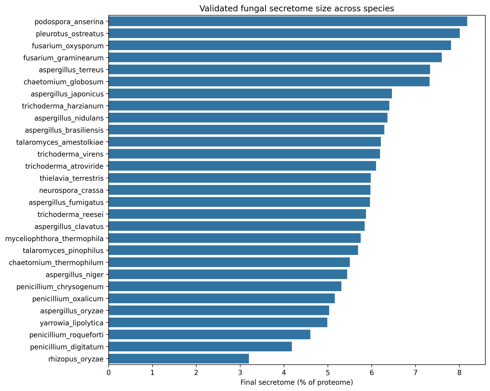
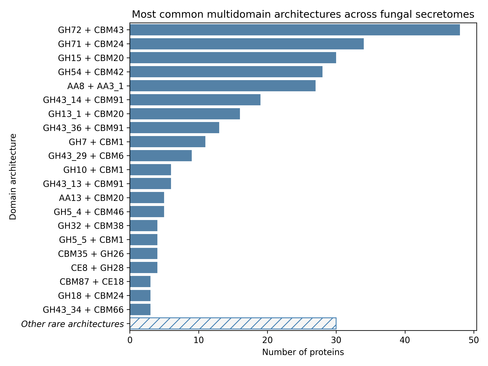
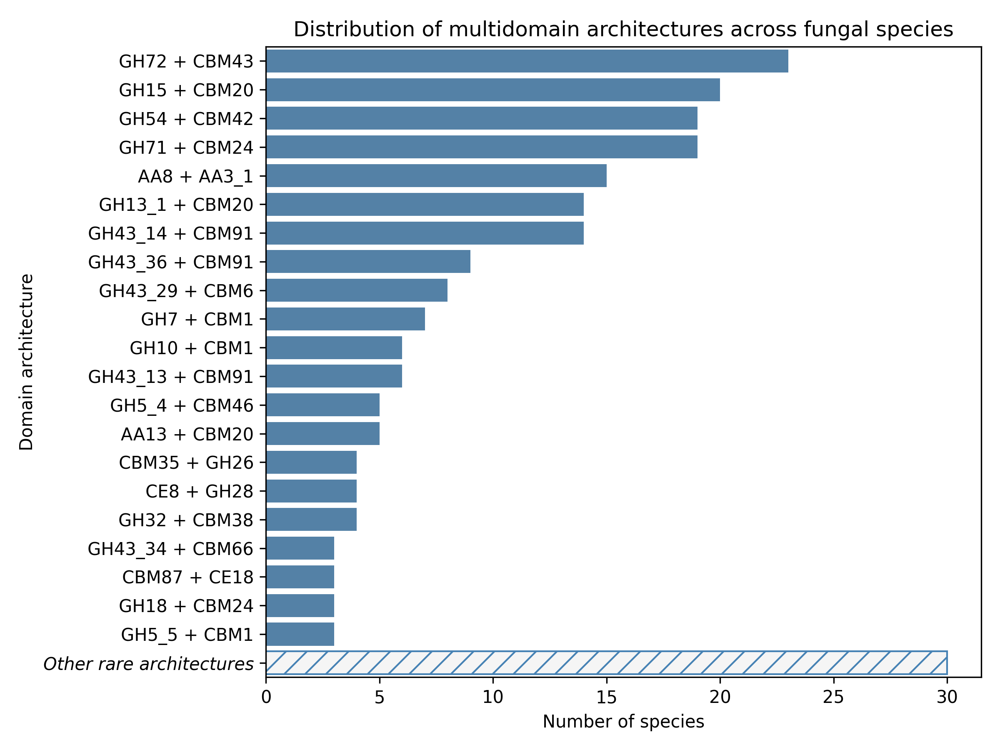
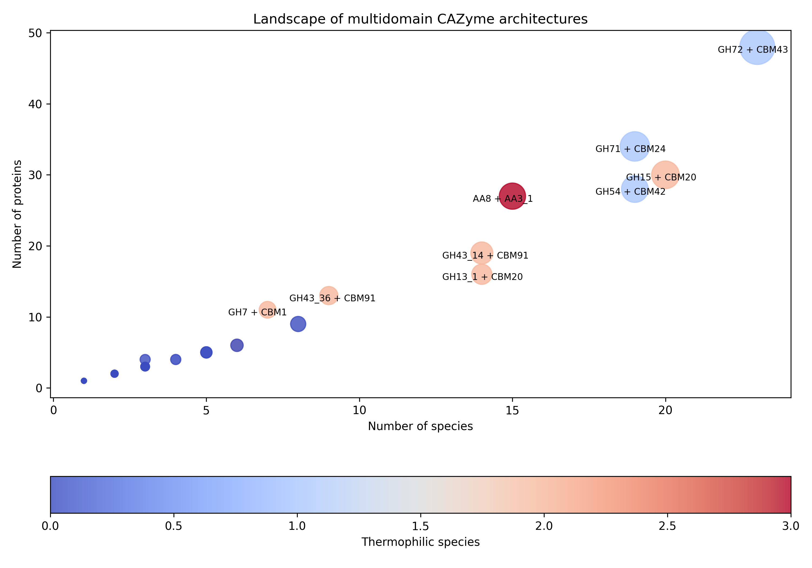
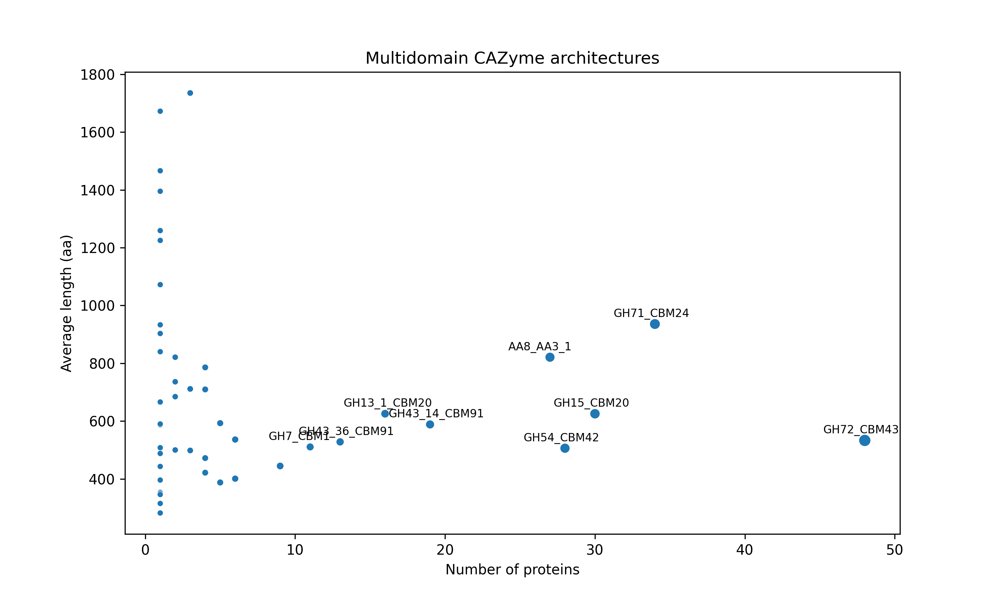
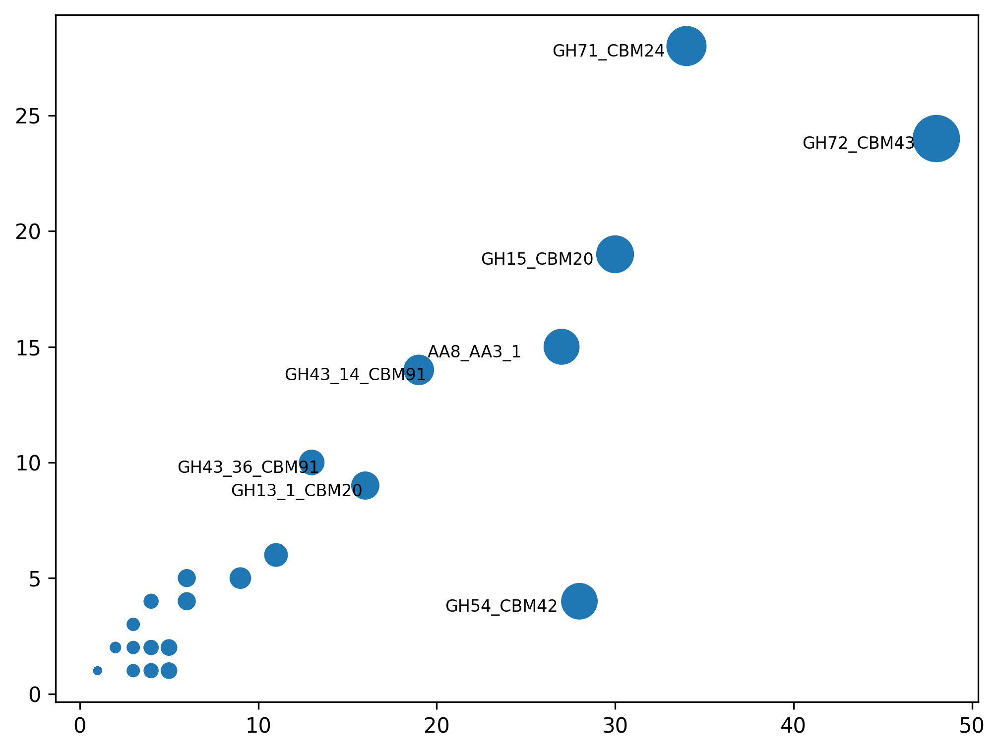
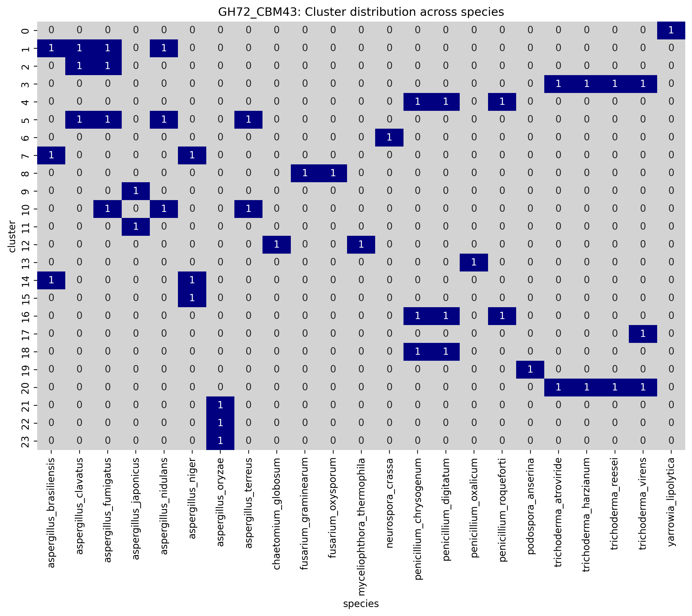
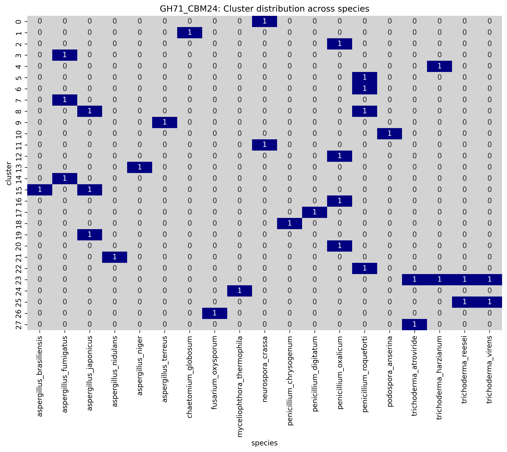
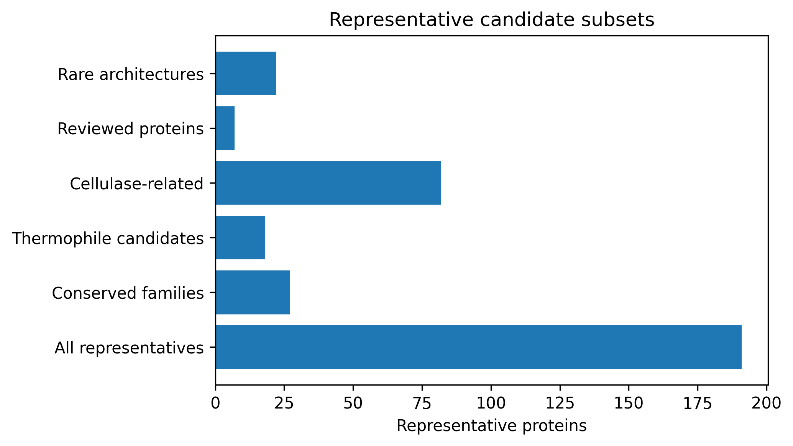
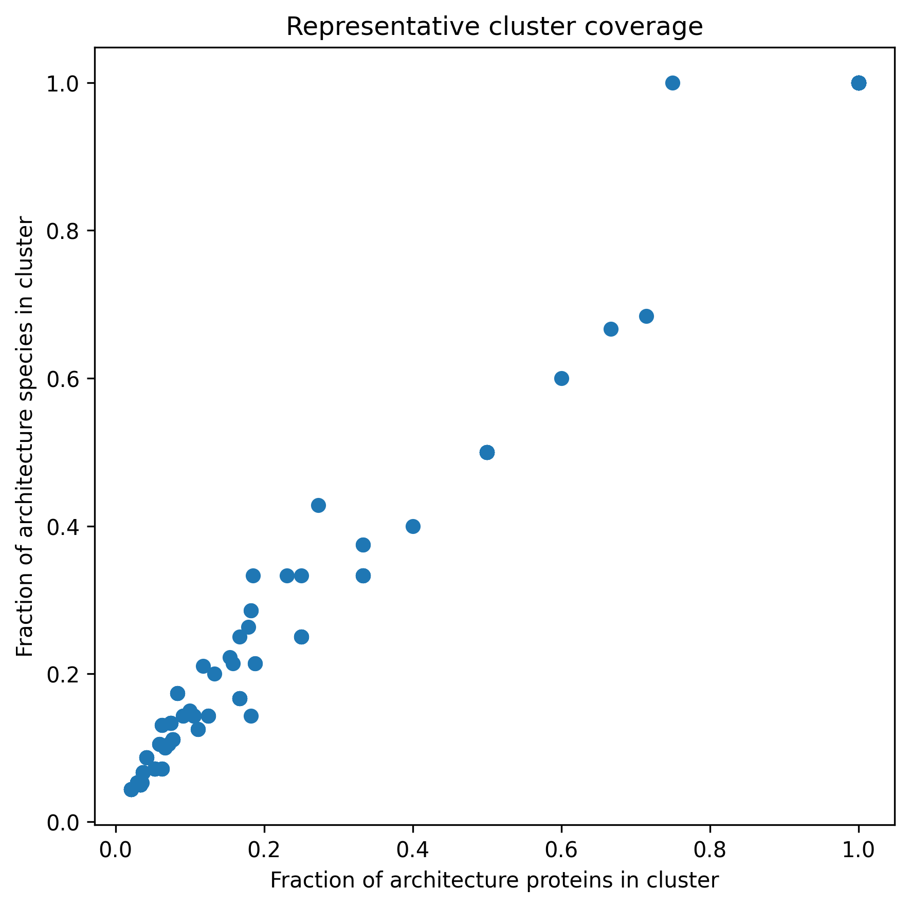

# Comparative Genome Mining of Multidomain Fungal CAZymes

Comparative genome-mining project focused on discovering secreted fungal carbohydrate-active enzymes (CAZymes) and multidomain enzyme architectures associated with plant biomass degradation.

---

# Project Goals

Industrial biomass conversion relies heavily on fungal carbohydrate-active enzymes (CAZymes), particularly secreted cellulases and oxidative accessory enzymes involved in plant cell wall deconstruction.

While many industrial enzymes have already been characterized, genome mining across diverse fungal species remains a powerful strategy for discovering:

- novel cellulases
- unusual multidomain architectures
- improved thermostability
- enhanced substrate binding
- synergistic catalytic combinations
- potentially patentable enzyme candidates

This project aims to build a reproducible comparative fungal secretome-mining pipeline capable of:

1. collecting fungal reference proteomes automatically from UniProt
2. predicting secreted proteins using SignalP 6
3. removing membrane-associated proteins using DeepTMHMM
4. annotating CAZyme domains using HMMER + dbCAN
5. reconstructing multidomain enzyme architectures
6. identifying rare or industrially relevant multidomain CAZyme architectures across fungi

The workflow combines complementary protein localization predictors to generate a high-confidence fungal secretome prior to CAZyme annotation. Rather than relying solely on signal peptide prediction, membrane-associated proteins are removed before downstream analysis, improving the biological realism of the predicted extracellular fungal secretome.

The workflow combines classical bioinformatics tools with large-scale comparative analysis and focuses on biologically interpretable results rather than black-box predictions.

---

# Biological Background

Filamentous fungi are among the most efficient degraders of lignocellulosic biomass in nature. Species such as *Trichoderma*, *Aspergillus*, *Penicillium*, and thermophilic fungi secrete large extracellular enzyme repertoires specialized for decomposition of cellulose, hemicellulose, and lignin-rich substrates.

Particularly important enzyme classes include:

- Glycoside Hydrolases (GH)
- Auxiliary Activities (AA)
- Carbohydrate Binding Modules (CBM)
- Polysaccharide Lyases (PL)
- Carbohydrate Esterases (CE)

Many industrially valuable enzymes contain multidomain architectures such as:

- catalytic GH + CBM combinations
- oxidative AA modules
- tandem substrate-binding domains

These architectures may improve:
- substrate accessibility
- catalytic efficiency
- processivity
- thermostability
- enzyme synergy on insoluble biomass

Because multidomain organization often determines substrate recognition, catalytic efficiency and enzyme synergy, identifying conserved and unusual domain combinations may reveal promising targets for enzyme engineering and industrial biotechnology.

---

# Species Selection

The dataset includes 29 fungal species selected based on:

- known cellulolytic capability
- industrial enzyme production
- ecological diversity
- thermophilic adaptation
- representation of major filamentous fungal groups

The collection includes:

- *Trichoderma*
- *Aspergillus*
- *Penicillium*
- *Fusarium*
- *Neurospora*
- *Pleurotus*
- thermophilic fungi such as:
  - *Chaetomium thermophilum*
  - *Thermothelomyces thermophilus*
  - *Thielavia terrestris*

Both mesophilic and thermophilic fungi were included to increase the likelihood of identifying unusual enzyme architectures and potentially thermostable candidates.

---

# Pipeline Overview

## 1. Automatic Proteome Retrieval

Reference fungal proteomes were automatically retrieved from UniProt using the REST API.

Selection logic:
- prioritize reference proteomes
- filter out viral entries
- prefer proteomes with realistic fungal protein counts
- fallback taxonomy-based retrieval when reference proteomes were unavailable

The download pipeline automatically generated:
- FASTA proteomes
- metadata report tables
- reproducible species annotations

---

## 2. Secretome Prediction with SignalP 6

Secreted proteins were predicted using a two-stage workflow:

### Fast Screening
SignalP 6 Fast model was first applied to complete fungal proteomes.

### Slow Validation
Proteins predicted as secreted by the Fast model were re-analyzed using the more computationally expensive `slow-sequential` model.

This approach is meant to:
- dramatically reduced runtime
- preserved high sensitivity
- removed low-confidence predictions

The workflow was benchmarked against full `slow-sequential` SignalP 6 predictions using the *Trichoderma reesei* proteome.

Comparison between Fast and Slow models showed:
- ~0.7% disagreement at the full proteome level
- ~9% disagreement within secretome-related predictions (including both Fast-only and Slow-only classifications)

To balance computational efficiency and prediction confidence, a two-stage Fast → Slow validation workflow was implemented:

1. Fast model screening on complete proteomes
2. Slow-sequential validation of Fast-positive secreted proteins

For *T. reesei*, this approach removed ~3.6% of Fast-predicted secreted proteins, which falls within the expected disagreement range between models.

Across all 29 fungal species:
- average Fast → Slow retention was ~96.5%
- only ~3.5% of Fast-positive proteins were rejected during Slow validation

This demonstrated that:
- SignalP Fast performs extremely well for fungal secretome screening
- Slow validation primarily removes marginal predictions
- the hybrid workflow preserves biological realism while dramatically reducing runtime

Performance benchmarking showed:
- Fast mode is ~6× faster than Slow-sequential
- full Slow-sequential analysis of 29 genomes would require approximately one week of continuous runtime on a typical desktop workstation
- the Fast → Slow strategy reduced total runtime by approximately 4.3× while preserving high-confidence predictions


### DeepTMHMM Filtering

Although SignalP accurately predicts N-terminal signal peptides, many membrane proteins also contain signal peptides required for entry into the secretory pathway. Such proteins are not truly secreted and are therefore unsuitable targets for extracellular enzyme discovery.

To improve secretome quality, all SignalP-validated proteins were analysed using DeepTMHMM. Only proteins classified as **SP (secreted proteins without transmembrane helices)** were retained for downstream CAZyme annotation.

Proteins classified as:

- **SP** — retained
- **SP+TM** — removed
- **TM** — removed
- **GLOB** — removed

This additional filtering step eliminated membrane-associated proteins before domain annotation, resulting in a biologically more accurate fungal secretome.


# Secretome Statistics

Across the 29 analysed fungal species:

- proteome sizes ranged from ~6,400 to ~15,500 proteins
- SignalP-predicted secretomes typically represented ~5–10% of each proteome
- Fast → Slow SignalP retention remained consistently high (~95–98%)
- DeepTMHMM retained approximately 84% of SignalP-validated proteins

Overall filtering results:

| Stage | Proteins |
|---------|---------:|
| SignalP Fast | 24,258 |
| SignalP Slow validation | 23,417 |
| DeepTMHMM final secretome | 19,631 |

DeepTMHMM removed 3,786 proteins (16.2%) that were predicted to contain transmembrane helices or lacked convincing evidence of secretion.

Overall, the pipeline reduced the initial set of SignalP-positive proteins by approximately **19%**, producing a conservative, high-confidence extracellular fungal secretome suitable for downstream CAZyme discovery.

This demonstrated that:

- SignalP Fast performs remarkably well for fungal secretome screening
- Slow validation primarily removes marginal signal peptide predictions
- DeepTMHMM eliminates membrane-associated proteins that would otherwise inflate the predicted secretome
- the resulting dataset represents a high-confidence extracellular fungal secretome suitable for downstream CAZyme discovery


---

# Example Secretome Refinement

| Species | Proteome | SignalP Fast | SignalP Slow | DeepTMHMM Final | Final Secretome | DeepTMHMM Retention |
|---|---:|---:|---:|---:|---:|---:|
| *Fusarium graminearum* | 14,147 | 1,298 | 1,259 | 1,075 | 7.60% | 85.39% |
| *Chaetomium globosum* | 11,038 | 1,009 | 974 | 808 | 7.32% | 82.96% |
| *Aspergillus niger* | 14,069 | 955 | 913 | 765 | 5.44% | 83.79% |
| *Trichoderma reesei* | 9,115 | 666 | 642 | 535 | 5.87% | 83.33% |
| *Penicillium oxalicum* | 9,977 | 660 | 630 | 515 | 5.16% | 81.75% |

---

## Secretome Fraction Across Fungal Species

The proportion of predicted secreted proteins varied substantially across fungal species, ranging from ~3% to ~8% of total proteomes.

Notable differences were observed between fungal groups:
- *Podospora anserina* and *Pleurotus ostreatus* showed the largest predicted secretomes
- *Rhizopus oryzae* exhibited a comparatively small secretome fraction

These differences likely reflect ecological specialization and distinct strategies of extracellular biomass degradation.



---

# CAZyme Annotation

Validated secretomes were annotated using:

- HMMER3
- dbCAN HMM database (v14)

Domain annotation was performed only after SignalP validation and DeepTMHMM filtering, ensuring that membrane-associated proteins were excluded before functional annotation.

This substantially reduces false-positive CAZyme predictions originating from intracellular or membrane-bound carbohydrate-active proteins.

The workflow identifies:

- CAZyme families
- catalytic domains
- carbohydrate-binding modules
- multidomain architectures

Additional filtering stages were implemented to:

- remove overlapping domain artifacts
- merge fragmented domain predictions
- reconstruct biologically realistic multidomain architectures


---

# Tools Used

- Python
- Pandas
- Biopython
- SignalP 6
- DeepTMHMM - 1.0
- HMMER3
- dbCAN v14
- UniProt REST API
- Jupyter Notebook
- WSL / Ubuntu

---

# Repository Structure

```text
data/               Input fungal proteomes
notebooks/          Analysis workflow
scripts/            Command-line helper scripts
tools/              Third-party software
results/            Generated tables, figures and intermediate files
```
---

# References

SignalP 6:
Teufel et al., 2022
https://www.nature.com/articles/s41587-021-01156-3

DeepTMHMM:
- Hallgren et al., 2022
https://doi.org/10.1101/2022.04.08.487609

dbCAN:

- dbCAN-HMMdb-V14.txt
https://pro.unl.edu/dbCAN2/browse_download.php

- Zhang et al., 2023
https://academic.oup.com/nar/article/51/W1/W115/7147496

cd-hit-v4.8.1-2019-0228:
-Fu, Limin, et al., 2012
https://academic.oup.com/bioinformatics/article/28/23/3150/192160

# Results: Discovery of Multidomain Biomass-Degrading Enzymes

## Objective

The goal of this stage was to identify multidomain carbohydrate-active enzymes (CAZymes) across fungal secretomes and prioritize architectures potentially relevant to lignocellulose degradation.

While many fungal enzymes consist of a single catalytic domain, multidomain enzymes may combine catalytic and substrate-binding functions within a single protein. Such architectures are particularly attractive for industrial enzyme discovery because carbohydrate-binding modules (CBMs) can improve substrate targeting and activity on insoluble biomass.

---

## Domain Annotation

DeepTMHMM-filtered fungal secretomes from 29 species were scanned against the dbCAN CAZyme HMM database using HMMER.

The initial search produced **59,372 raw HMM matches** across **7,449 proteins**. These represent all statistically significant matches reported by HMMER, including multiple overlapping hits, partial matches, and redundant domain assignments.

To obtain a high-confidence CAZyme dataset, several filtering steps were applied:

* domain E-value threshold (**E-value < 1×10⁻¹⁵**)
* HMM coverage threshold (**≥35%** of the model length)
* overlap filtering to remove redundant domain predictions
* merging of adjacent hits belonging to the same CAZyme family

This progressively refined the dataset:

| Stage                              | Domain Hits |
| ---------------------------------- | ----------: |
| Raw HMM matches                    |      59,372 |
| After E-value & coverage filtering |      17,662 |
| After overlap filtering            |       6,363 |
| After domain merging               |       6,315 |

The final dataset contained **6,315 high-confidence CAZyme domain assignments** distributed across **5,971 unique secreted proteins**.

These filtered domain annotations formed the basis for multidomain architecture reconstruction and downstream comparative analyses.


---

## Multidomain Architecture Reconstruction

Filtered domains were assembled into protein architectures.

Results:

| Metric | Value |
|---------|---------:|
| CAZyme proteins | 5,971 |
| Multidomain proteins | 312 |
| Distinct multidomain architectures | 55 |
| Distinct multidomain architectures (excluding homomeric repeats) | 47 |

Architectures consisting solely of repeated copies of the same domain were excluded from further analysis to focus on combinations of different functional modules.

---

## Most Common Architectures

The most abundant multidomain architectures identified across fungal secretomes were:

| Architecture | Proteins | Species |
|---------|---------:|---------:|
| GH72 + CBM43 | 48 | 23 |
| GH71 + CBM24 | 34 | 19 |
| GH54 + CBM42 | 28 | 19 |
| GH7 + CBM1 | 11 | 7 |
| GH10 + CBM1 | 6 | 6 |

Interestingly, these top architectures combine catalytic CAZyme domains with carbohydrate-binding modules and represent promising candidates for biomass conversion applications.



---

## Architecture Distribution Across Species

Some multidomain architectures occur repeatedly within a small number of species, whereas others are conserved across diverse fungal lineages. To distinguish between abundance and evolutionary distribution, architectures were ranked by the number of species in which they were detected.




---

## Thermophilic Fungi

Three thermophilic fungi were included in the dataset:

- *Myceliophthora thermophila*
- *Thielavia terrestris*
- *Chaetomium thermophilum*

Most multidomain architectures found in thermophiles were also present in mesophilic fungi, suggesting that adaptation to elevated temperatures may occur primarily through sequence-level evolution rather than through acquisition of unique domain architectures.

---

## Architecture Landscape

The distribution of architectures across proteins and species revealed a small number of highly conserved solutions alongside numerous rare architectures.




---

## Protein Length Analysis

Proteins sharing the same multidomain architecture were exported into architecture-specific FASTA files prior to sequence clustering.

Protein lengths were summarized to assess structural variability within each architecture.

Although many architectures exhibited relatively uniform protein sizes, several displayed substantial variation caused by long linker regions or additional accessory domains.

Examples include:

- **GH71 + CBM24**, ranging from approximately **570 to 1,740 amino acids**
- **GH18 + CBM24**, containing unusually large secreted chitinases exceeding **2,000 amino acids**

These observations illustrate that proteins sharing the same domain architecture may still differ considerably in overall sequence organization.




---

## Homology Clustering

To reduce redundancy while preserving functional diversity, proteins were clustered independently within each multidomain architecture using **CD-HIT** at a **70% sequence identity threshold**.

Clustering within architectures avoids merging proteins with different domain organizations while collapsing highly similar homologous proteins into representative sequence groups.

The **70% identity threshold** was selected to:

- reduce redundancy among closely related proteins
- preserve sequence diversity within each architecture
- retain representatives of potentially distinct functional variants

One representative sequence was retained from each cluster while preserving links to all cluster members.

Across the dataset:

- **47** multidomain architectures were analysed
- **191** representative proteins were identified
- representatives covered **all 29 fungal species**

Architectures displayed markedly different levels of sequence conservation.

Some formed only a few large sequence clusters, whereas others fragmented into many smaller groups despite sharing identical domain architectures.




---

## Conservation across fungal species

Cluster membership frequently reflected fungal phylogeny.

Some multidomain architectures contained one broadly conserved sequence cluster distributed across multiple genera, whereas others consisted primarily of lineage-specific variants.

For example, **GH72 + CBM43** and **GH71 + CBM24** exhibit multiple conserved sequence groups that recur across independent fungal lineages.

These patterns suggest repeated conservation of function together with lineage-specific diversification.

Example cluster distributions:

GH72 + CBM43



GH71 + CBM24




# Final Candidate Selection

The final representative dataset was organized into several biologically relevant subsets to facilitate downstream enzyme discovery.

Representative proteins were classified into several biologically relevant subsets.

These subsets are intended to support different downstream objectives, ranging from comparative genomics and evolutionary analyses to enzyme engineering and experimental characterization.

Representative proteins were classified into:

- conserved multidomain families
- Cellulose-degrading architectures
- thermophile-derived candidates
- experimentally reviewed proteins
- rare multidomain architectures

This strategy allows users to prioritize candidates according to different research objectives without repeating the complete analysis pipeline.

Final representative dataset:

- **191 representative proteins**
- **47 multidomain architectures**
- **29 fungal species**

Representative subsets:

| Category | Representatives |
|-----------|---------------:|
| All representatives | 191 |
| Cellulose-degrading | 82 |
| Conserved families | 27 |
| Rare architectures | 22 |
| Thermophile candidates | 18 |
| Reviewed proteins | 7 |




## Representative cluster coverage

Representative proteins were selected from sequence clusters rather than individual proteins.

Each representative therefore captures a homologous sequence group while preserving links to all proteins belonging to that cluster.

Architectures with points near the upper-right corner are dominated by a single conserved sequence group.

Architectures near the lower-left corner contain many distinct homologous groups and therefore represent richer sources of sequence diversity.




# Pipeline Outputs

The pipeline produces several reusable datasets for downstream comparative analyses.

Main outputs include:

| File | Description |
|------|-------------|
| representative_candidates.csv | Final non-redundant representative proteins |
| cluster_members.csv | Mapping between representatives and cluster members |
| architecture_summary.csv | Architecture-level statistics |
| architecture_fasta_summary.csv | FASTA datasets used for clustering |
| conserved_candidates.csv | Representatives from conserved sequence groups |
| cellulase_candidates.csv | Cellulose-degrading representatives |
| thermophile_candidates.csv | Representatives from thermophilic fungi |
| reviewed_candidates.csv | Experimentally reviewed representatives |
| rare_architectures.csv | Representatives of unique multidomain architectures |

Together, these datasets reduce thousands of predicted secreted proteins to a compact collection of representative multidomain enzymes while preserving the observed sequence and architectural diversity.

They provide a practical starting point for comparative genomics, enzyme engineering, experimental validation and industrial enzyme discovery.

# Pipeline Summary

| Analysis stage | Proteins remaining |
|----------------|------------------:|
| Complete fungal proteomes | 336,213 |
| SignalP Fast predictions | 24,258 |
| SignalP Slow validation | 23,417 |
| DeepTMHMM-filtered secretome | 19,631 |
| Secreted CAZyme proteins | 5,971 |
| Multidomain CAZymes | 312 |
| Representative candidates | **191** |

The workflow progressively reduces large fungal proteomes to a compact, biologically meaningful collection of representative multidomain CAZymes suitable for downstream comparative analysis and enzyme discovery.

# Conclusion

A reproducible comparative fungal secretome-mining pipeline was developed for the discovery and prioritization of multidomain carbohydrate-active enzymes.

Starting from complete fungal proteomes, the workflow combines:

- automated proteome retrieval
- two-stage SignalP 6 secretome prediction
- DeepTMHMM transmembrane filtering
- dbCAN HMM annotation
- multidomain architecture reconstruction
- sequence clustering
- representative candidate selection

Application to **29 fungal species** identified:

- **5,971 secreted CAZyme proteins**
- **312 multidomain enzymes**
- **47 distinct multidomain architectures**
- **191 representative proteins** spanning all identified sequence clusters

The resulting representative dataset substantially reduces redundancy while preserving the diversity of multidomain CAZyme architectures, providing a practical collection of candidates for comparative analysis, protein engineering and experimental characterization.

Rather than producing a single "best enzyme", the workflow generates a structured, biologically interpretable candidate space that can be explored according to different research questions and industrial objectives.

The complete workflow is fully reproducible and can be readily extended to newly sequenced fungal genomes or adapted to other classes of secreted enzymes.

# Outlook

Several extensions could further improve the pipeline and broaden its applications for industrial enzyme discovery.

Potential future developments include:

- integration of AlphaFold structural models for representative proteins
- automated prediction of thermostability and protein stability
- identification of catalytic residues and substrate-binding sites
- incorporation of protein language model embeddings for sequence similarity analysis
- automated comparison against experimentally characterized CAZymes
- taxonomic conservation analysis of multidomain architectures
- novelty assessment against public patent sequence databases
- expansion to newly sequenced fungal genomes and additional microbial taxa

Because each analysis stage is modular, these extensions can be incorporated without substantial modification of the overall workflow.